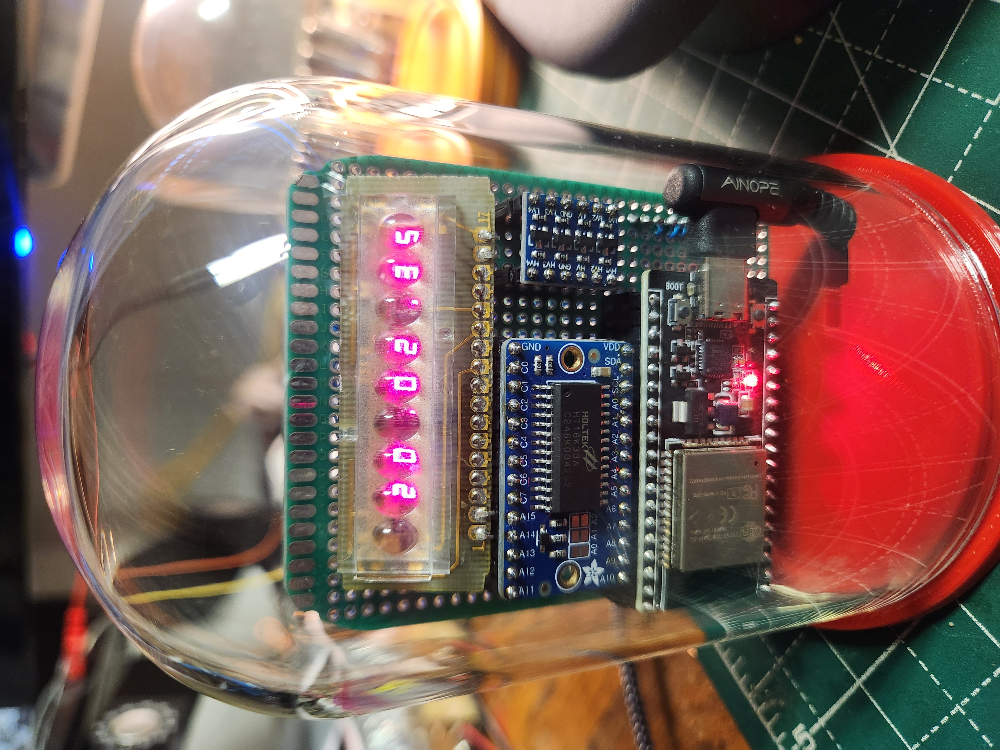

# Bubble LED Clock 2 — ESP-IDF Port

An ESP-IDF port of [BubbleLEDClock](https://github.com/v01dma1n/BubbleLEDClock) — an 8-digit 7-segment "bubble" LED clock driven by an HT16K33 controller over I2C. Features automatic NTP time synchronization, weather display from OpenWeatherMap, and a web-based configuration portal. Built on the shared [`esp32_ntp_clock`](https://github.com/v01dma1n/ESP32NTPClock2) IDF component framework also used by [GustavClock2](https://github.com/v01dma1n/GustavClock2).



---

## ✨ Features

- **8-Digit Bubble LED Display:** Vintage 7-segment "bubble" LED digits driven by an HT16K33 controller over I2C.
- **Automatic Time Sync:** Connects to your WiFi and synchronizes from NTP servers with full POSIX timezone support.
- **Weather Display:** Fetches current temperature (°F and °C) and humidity from OpenWeatherMap and cycles them through the scene playlist.
- **Animated Scenes:** Cycles through time, date, temperature, and humidity using Slot Machine, Matrix, and Scrolling Text animations.
- **Web Configuration:** On first boot or when WiFi fails, the clock enters AP mode. Connect to its network and open `192.168.4.1` to configure all settings.
- **Double-Reset AP Mode:** Press the reset button twice in quick succession (~1 s apart) to re-enter the configuration portal at any time.
- **DS1307 RTC:** Battery-backed real-time clock seeds the system time at boot so the display works immediately before NTP sync.

---

## ⚙️ Hardware

| Part | Details |
|------|---------|
| ESP32 module | ESP32-WROOM-32 dev board (e.g. HiLetgo USB-C variant) |
| Display driver | HT16K33 breakout (e.g. Adafruit 1427) over I2C |
| Display | 8-digit 7-segment common-anode "bubble" LED (sourced from a 1970s pocket calculator) |
| RTC | DS1307 module with backup battery (SDA=21, SCL=22) |
| Level shifter | 3.3 V → 5 V I2C level shifter (recommended for 5 V display/RTC modules) |
| Power | 5 V supply |

### Pin assignments

| Signal | GPIO |
|--------|------|
| I2C SDA | 21 |
| I2C SCL | 22 |
| HT16K33 address | 0x70 |
| DS1307 address | 0x68 |
| WiFi activity LED | 2 (built-in) |

---

## 🧩 Component Architecture

```
BubbleLEDClock2/
├── components/
│   ├── esp32_ntp_clock/           # Shared clock engine (ESP-IDF port of ESP32NTPClock)
│   │   ├── display_manager, scene_manager, clock_fsm_manager
│   │   ├── wifi_connector, sntp_client, geo_tz_client
│   │   ├── weather_client, boot_manager, animations …
│   └── esp32_ntp_clock_drivers/   # Hardware drivers
│       ├── disp_driver_ht16k33    # HT16K33 I2C display driver
│       └── ds1307_driver          # DS1307 RTC driver
└── main/
    ├── bubble_led_clock_app            # App singleton, scene playlist
    ├── bubble_led_clock_preferences    # NVS-backed config (WiFi, OWM, timezone …)
    ├── bubble_led_clock_access_point_manager
    └── bubble_led_clock_hardware_map   # GPIO / I2C pin assignments
```

---

## 🖨️ 3D-Printed Enclosure

A printable base for the clock is included in the `3d/` directory:

- `Bubble Display Clock Base - V11 Notches Added.step` — STEP file for the display base

---

## 🛠️ Configuration

1. **First Boot:** The clock starts in AP mode. The display scrolls `BUBBLE LED CLOCK`.
2. **Connect to the AP:** Join the WiFi network **`bubble-clock`**.
3. **Open the portal:** Navigate to **`192.168.4.1`** in your browser.
4. **Enter settings:**
   - WiFi SSID and password
   - [POSIX timezone string](https://remotemonitoringsystems.ca/time-zone-list.php) (e.g. `EST5EDT,M3.2.0/2,M11.1.0/2`)
   - OpenWeatherMap API key
   - City, State Code, Country Code (e.g. `New York`, `NY`, `US`)
   - Temperature unit (°F or °C)
   - Show startup animation (on/off)
5. **Save:** Click *Save and Restart*. The clock reboots and connects to your WiFi.

To re-enter configuration mode at any time, press the **reset button twice** in quick succession (~1 second apart).

---

## 🚀 Building

Requires [ESP-IDF v5.x](https://docs.espressif.com/projects/esp-idf/en/stable/esp32/get-started/index.html).

```bash
git clone --recurse-submodules https://github.com/v01dma1n/BubbleLEDClock2.git
cd BubbleLEDClock2
idf.py set-target esp32
idf.py build
idf.py -p /dev/ttyUSB0 flash monitor
```

`sdkconfig.defaults` is included — no manual `menuconfig` needed for normal builds.

---

## 🔑 Differences from BubbleLEDClock (Arduino)

| | BubbleLEDClock (Arduino) | BubbleLEDClock2 (ESP-IDF) |
|---|---|---|
| Framework | Arduino / ESP32 core | ESP-IDF v5 |
| Display driver | `DispDriverHT16K33` (Arduino Wire) | `DispDriverHT16K33` (IDF `i2c_master`) |
| NVS / prefs | `Preferences.h` | `nvs_flash` IDF API via `BasePreferences` |
| RTC | `RTClib` `RTC_DS1307` | `Ds1307Driver` (IDF I2C, shared bus) |
| AP trigger | double-reset via `BootManager` | double-reset via `BootManager` |
| Weather client | `openweather_client` (returns configured unit) | `weather_client` (always returns °C; °F derived on display) |
| Temperature scenes | single getter for configured unit | separate `getTempF()` / `getTempC()` — both units always shown |
| Task model | Arduino `loop()` on single core | FreeRTOS `AppTask` (Core 0) + `DisplayTask` 50 Hz (Core 1) |
| Submodules | Arduino libraries | `esp32_ntp_clock` + `esp32_ntp_clock_drivers` git submodules |

---

## 📚 Dependencies

Both component libraries are included as git submodules:

- **[ESP32NTPClock2](https://github.com/v01dma1n/ESP32NTPClock2)** — clock engine (WiFi, NTP, FSM, animations, scene manager, weather client)
- **[ESP32NTPClockDrivers2](https://github.com/v01dma1n/ESP32NTPClockDrivers2)** — hardware drivers (HT16K33, DS1307, MAX6921, …)

---

## 📜 License

MIT License — see `LICENSE` for details.
